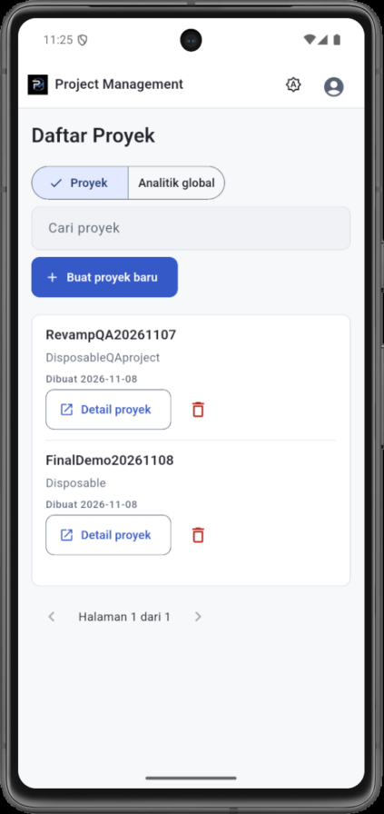
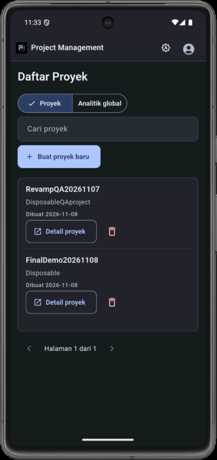

# Project Management Mobile App

A Flutter (Android-first) companion app for a project management system. It signs users in against an existing Go REST API, then lets them manage projects, Kanban columns, tasks, board members, assignees, and workload analytics. The Go backend, PostgreSQL database, and React frontend are separate and are **not** part of this repository.

| Light | Dark |
| --- | --- |
|  |  |

More screenshots are in [docs/screenshots/](docs/screenshots/).

## Verified Features

- Registration, login, session persistence across restarts, and logout. Back from the login screen never reopens protected pages.
- Projects: list, search, pagination, creation, deletion with confirmation, and a protected detail page with collapsible project metadata.
- Kanban board: server-ordered columns (create, rename, delete) and tasks (create, edit title/description/deadline, delete). Tasks move between columns with the **Pindahkan tugas** selector or by long-press drag and drop; a move appends to the destination column.
- Members and assignees: paginated user search, add/remove board members, multi-select task assignment, and per-user unassignment.
- Board summary (**Ringkasan**): task count per column, assignee workload, unassigned count, and overdue / due-soon lists.
- Global analytics: assignment counts from `/api/v1/dashboard/workload` (aggregated by the backend, not per project or user).
- Material 3 design system with **System**, **Light**, and **Dark** themes. The choice persists across restarts and is available from the login, registration, and app bars.
- Responsive layouts: a list layout on phones and a table on wide screens, full-screen dialogs on phones, and large-text support (checked at 2.0× font scale).

## Technology Stack

- Flutter and Dart (`pubspec.yaml`: Dart `^3.13.5`; the lockfile requires Flutter `>=3.44.0`) with Material 3.
- `http` for API calls and `shared_preferences` for local session and theme storage. No state-management framework; state lives in `StatefulWidget`s and static service classes.
- `flutter_test` and `flutter_lints` for widget tests and static analysis.
- External backend (not in this repo): Go REST API backed by PostgreSQL.

## Installation

```sh
flutter pub get
```

Requirements: a Flutter SDK matching the versions above, and an Android emulator or device with the Android toolchain.

## QA Configuration

For the academic demo the app always uses the **QA** backend, `http://43.173.10.180:3030` (plain HTTP). The DEV/QA selector is hidden on the login and registration screens. The environment code is still in the repository (`lib/environment_config.dart`; `LoginPage(showEnvironmentSelector: true)` shows the selector for tests). A stored DEV preference is reset to QA at startup, and a session saved for another environment is discarded instead of being reused.

Do not put credentials or tokens in the repository.

## Running

```sh
flutter run
```

The app opens on the login screen. Create a disposable account with **Daftar baru**, or use an account you are authorized to use on QA.

## Testing

```sh
flutter analyze --no-pub
flutter test --no-pub
flutter build apk --debug --no-pub
```

The debug APK is written to `build\app\outputs\flutter-apk\app-debug.apk`. Gradle prints a restricted `System.load` warning that does not affect the build.

Last verified on 2026-11-07 (Windows, Flutter debug build, Android 15 emulator against the QA backend):

- `flutter analyze --no-pub`: no issues.
- `flutter test --no-pub`: 176 tests passed.
- `flutter build apk --debug --no-pub`: succeeded.
- All ten scenarios in [MANUAL_TESTING.md](MANUAL_TESTING.md) were run on the emulator against QA with disposable data, which was then deleted.

Test suites cover authentication and validation, environment isolation and sessions, projects, Kanban boards, tasks, members and summaries, global analytics, themes, and compact layouts. See [AGENTS.md](AGENTS.md) for the file map.

## Documentation

- [docs/ARCHITECTURE.md](docs/ARCHITECTURE.md): layers, authentication, API calls, and data flows.
- [docs/PORTFOLIO.md](docs/PORTFOLIO.md): project summary for portfolio use.
- [docs/DEMO_GUIDE.md](docs/DEMO_GUIDE.md): demonstration script in Indonesian.
- [MANUAL_TESTING.md](MANUAL_TESTING.md): ten-step manual checklist in Indonesian.

## Known Limitations

- QA and DEV endpoints use plain HTTP; credentials and tokens can be intercepted on untrusted networks. Use only with test data.
- The backend does not authorize access per board. Its board-member `GET` returns raw user records, including password hashes; the app reads only `public_id`, `name`, and `email` and never stores the rest. These are backend risks that block production use.
- Global workload is not scoped by project or user and groups by assignee name, so duplicate names merge. The `task-percentage` endpoint returns counts, not percentages, and the app does not present it as percentages.
- The backend has no reorder routes, so moves always append to the destination column. Comments, labels, attachments, and checklists are not supported.
- A new project with no columns returns an error from the column endpoint; the app shows a recovery message with **Tambah kolom**.
- If the saved session cannot be cleared, the app warns that it may return after a restart.
- If theme preferences cannot be read, the app falls back to System; if they cannot be saved, the new theme applies until restart and a warning is shown.
- There is no account-deletion feature, so accounts created during testing stay on QA.
- Android release builds use debug signing and need proper signing before distribution.
