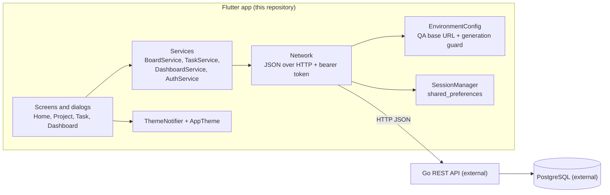
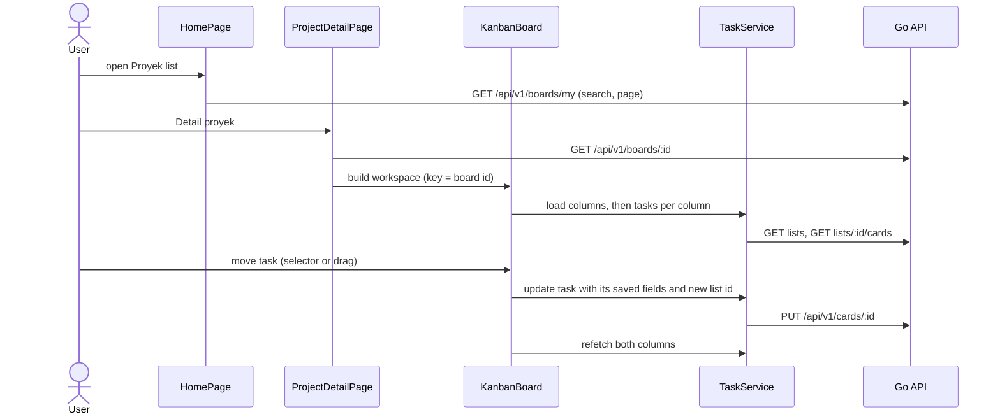

# Architecture

This document describes the Flutter client as implemented in this repository. The Go REST API and PostgreSQL database are external; only the contract the app depends on is described.

## Overview

## Layers

| Layer | Files | Responsibility |
| --- | --- | --- |
| Entry and routing | `lib/main.dart`, `lib/app_navigation.dart` | Initializes the saved theme, builds `MaterialApp` with `AppTheme.light` / `AppTheme.dark`, defines `/login`, `/signup`, `/`, and `/projects/:id`. Protected routes load the session first and show the login page when it is missing. |
| Screens | `lib/System Login/`, `lib/Home/`, `lib/Project/`, `lib/Task/`, `lib/Dashboard/`, `lib/Modal/` | Stateful widgets with local state and controllers. Dialogs own their own pending state. |
| Services | `lib/network.dart`, `lib/Task/task_service.dart`, `lib/Dashboard/dashboard_service.dart` | Static methods that build endpoints, parse responses into models (`lib/Task/task_models.dart`), and surface errors. |
| Environment and session | `lib/environment_config.dart`, `lib/session_manager.dart` | Selects the backend, serializes session writes, and tags every saved session with its environment. |
| Design system | `lib/ui/Theme/` | `AppTheme` (Material 3 color roles, type scale, component themes), `ThemeNotifier` (persisted System/Light/Dark), `ThemeToggle` (chooser dialog). |

There is no dependency injection or state-management package. Networking, session, and theme access use static members.

## Authentication and Session

1. `LoginPage` asks `EnvironmentConfig.snapshot()` for the base URL, environment name, and a generation number.
2. `AuthService.login` sends `POST /v1/auth/login`. Registration uses `POST /v1/auth/register` and returns to the login screen.
3. The response must contain `data.access_token`. `EnvironmentConfig.saveSessionIfCurrent` stores the session only if the generation and environment still match, then increments the generation.
4. `SessionManager` writes a temporary invalidation marker, the session JSON, and the environment tag, then removes the marker. If any write fails it removes partial data and throws.
5. Protected routes read the session for the current environment and require a non-empty `access_token`.
6. Logout calls `EnvironmentConfig.logout`, which increments the generation and clears the session, then replaces the stack with `/login`.

QA is the only environment the app uses. At startup `EnvironmentConfig` selects QA, rewrites a stored `dev` preference to `qa`, and removes any session whose tag differs from QA. The DEV constant and `select()` remain in the code so tests can still cover switching.

The generation counter makes stale work harmless: a response that arrives after logout, a 401 elsewhere, or an environment change cannot save or clear a newer session.

## API Communication

`Network` provides `get`, `post`, `put`, and `delete`. Each request resolves an environment snapshot, adds `Authorization: Bearer <token>` when requested, sends JSON, and decodes a JSON response (errors must be JSON too). Non-2xx responses throw `NetworkHttpException` with the server message. An HTTP 401 raises `UnauthorizedException`; the app invalidates only the session that sent the request and returns to login.

Endpoints used by the app (all relative to the QA base URL):

| Area | Endpoints |
| --- | --- |
| Auth | `POST /v1/auth/login`, `POST /v1/auth/register` |
| Projects | `GET /api/v1/boards/my`, `POST /api/v1/boards`, `GET` / `DELETE /api/v1/boards/:id` |
| Members | `GET` / `POST` / `DELETE /api/v1/boards/:id/members`, `GET /api/v1/users/page` |
| Columns | `GET /api/v1/boards/:id/lists`, `POST /api/v1/lists`, `PUT` / `DELETE /api/v1/lists/:id` |
| Tasks | `GET /api/v1/lists/:id/cards`, `POST /api/v1/cards`, `GET` / `PUT` / `DELETE /api/v1/cards/:id` |
| Assignees | `POST` / `DELETE /api/v1/cards/:id/assignees` |
| Analytics | `GET /api/v1/dashboard/workload` |

## Project, Board, and Task Flows

- **Projects.** `HomePage` owns search (1 s debounce), pagination, and delete guards. Requests carry a request id so a slow response cannot overwrite a newer search.
- **Workspace.** `ProjectDetailPage` shows the project header and a collapsible **Detail proyek** panel. `KanbanBoard` (keyed by board id) loads server-ordered columns, then each column's tasks; one failed column does not hide the others.
- **Tasks.** Creating a task appends to its column. The detail dialog edits title, description, and deadline, keeps a dirty draft, and blocks **Pindahkan tugas** until the draft is saved. A move sends the full saved task with the destination list id and then refetches. Drag and drop calls the same move handler and is append-only.
- **Members and assignees.** The members dialog searches `/api/v1/users/page` with a debounce and adds or removes users. The task dialog lists board members as checkboxes, sends one assignment request, and confirms the result by refetching the task. Removing a board member does not unassign tasks.

## Analytics

- **Board summary (Ringkasan)** is computed on the device by `computeTaskSummary` from per-task detail requests: counts per column, workload per assignee, unassigned count, and overdue or due-in-1–3-days lists. If any detail request fails, the summary is marked incomplete and offers retry instead of showing partial numbers.
- **Global analytics** reads `GET /api/v1/dashboard/workload`, a raw array of `{assignee, taskCount}`. The backend aggregates it across all projects and groups by assignee name, so the screen states that scope and does not show percentages. A JSON `null` response is treated as an empty list; an envelope instead of an array is rejected.

## Theming and Layout

`AppTheme` defines explicit Material 3 color schemes for light and dark, a `ThemeExtension` for status colors, and shared component themes (inputs, buttons, cards, dialogs, snackbars). `ThemeNotifier.themeMode` feeds `MaterialApp.themeMode`; `System` follows the operating system. Layouts switch at 600 dp: a flat list or full-screen dialog below, a table or bounded dialog above. Home content is capped at 1120 dp wide.

## Testing Approach

Widget and service tests use `MockClient` and in-memory `SharedPreferences`. They cover session isolation and stale responses, protected navigation, project and Kanban workflows, members and summaries, analytics edge cases, theme persistence and System mode, and compact or large-text layouts. The manual checklist in [MANUAL_TESTING.md](../MANUAL_TESTING.md) covers the live QA backend.
