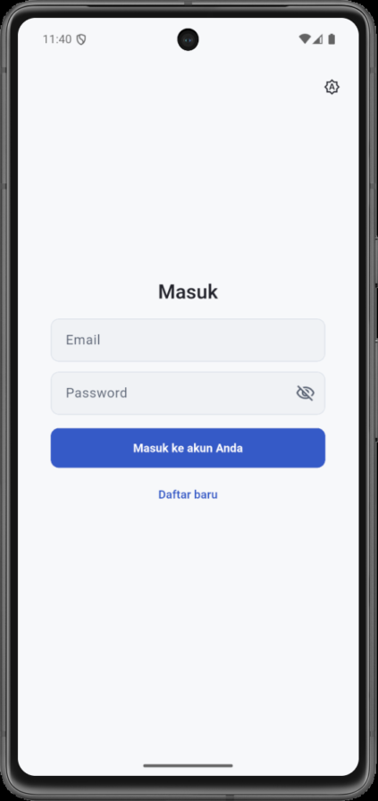
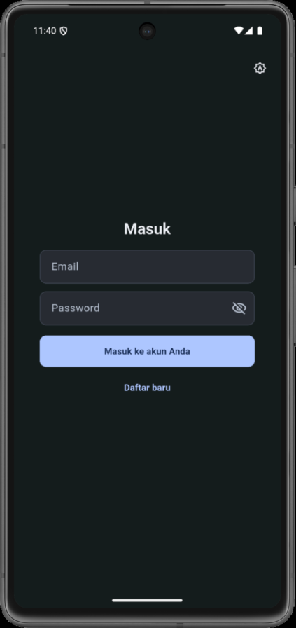
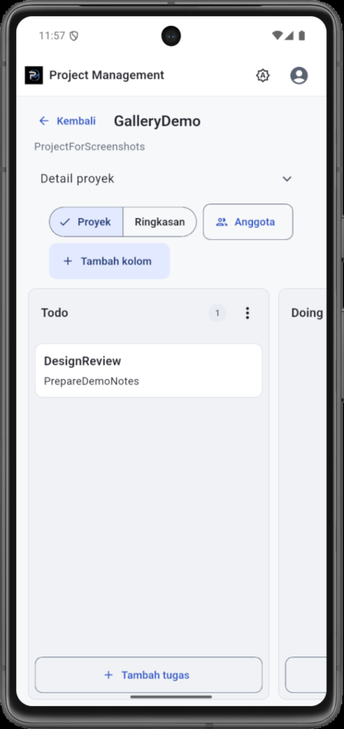
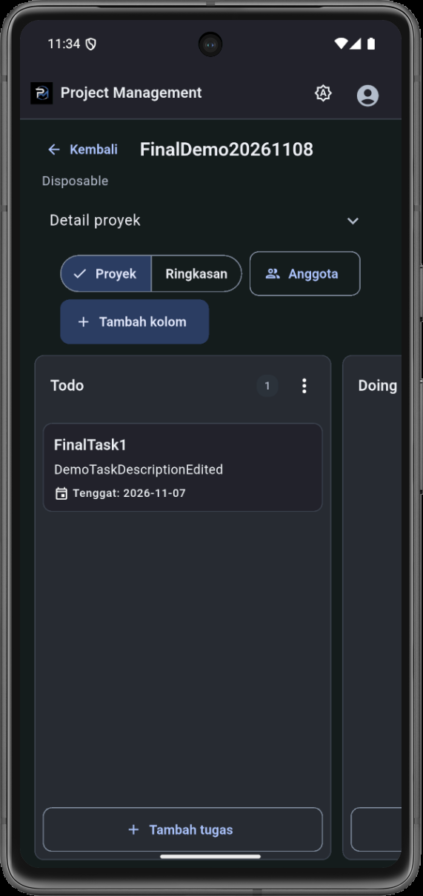
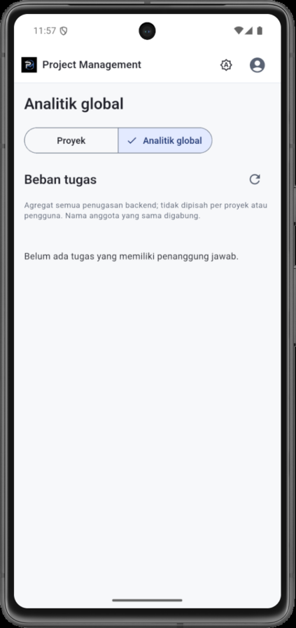
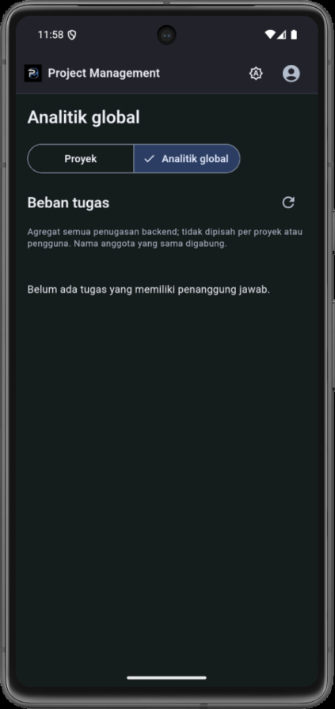

# Project Management Mobile App — Portfolio Overview

## Objective

Provide mobile access to an existing project management system as a companion to its React web application. The Flutter app reuses the same Go REST API and PostgreSQL data instead of introducing a separate mobile data source. This repository contains only the Flutter client.

## What the App Does

- Registration, login, session persistence, and logout.
- Project list with search, pagination, creation, deletion, and a protected detail page.
- Kanban board with columns and tasks; tasks move between columns via a selector or drag and drop.
- Board members, task assignees, a board summary, and global workload analytics.
- System, Light, and Dark themes that persist across restarts.

## Screens

| Light | Dark |
| --- | --- |
|  |  |
|  |  |
|  |  |

## Architecture

A layered Flutter client: screens, static service classes, a JSON `Network` client, and an environment/session layer, with no state-management package. A generation counter protects against stale responses after logout, a 401, or an environment change. See [ARCHITECTURE.md](ARCHITECTURE.md) for the diagrams and endpoint list.

Technology: Flutter and Dart (Material 3), `http`, `shared_preferences`, `flutter_test`, `flutter_lints`. External: Go REST API and PostgreSQL.

## UI/UX Design

The interface follows a minimalist productivity direction on Material 3:

- One restrained blue accent, flat surfaces with 1 px borders, and a single type scale using the platform font.
- Explicit light and dark color schemes (not an inversion), designed together, plus a status-color extension.
- Phone-first layouts: project rows instead of a wide table, full-screen task and member dialogs, and a collapsible project-details panel so the board stays visible.
- A theme chooser (System, Light, Dark) reachable from the login screen onward.
- Buttons with a 48 dp minimum height and text that wraps at 2.0× font scale.

## Technical Challenges

- **Stale asynchronous results.** Searches, deletions, task moves, and logins can overlap. Request ids, board-scoped keys, and the environment generation counter keep a late response from overwriting newer state or restoring a cleared session.
- **Session safety.** Sessions are tagged with the environment that created them, written behind an invalidation marker, and cleaned up if a write fails.
- **Backend constraints.** The API has no reorder route, so moves append. Workload analytics are global and grouped by name, and the app labels them honestly rather than implying per-project data.
- **Redesign without functional change.** The visual redesign was applied across existing screens while the existing regression suite stayed in place. Test selectors changed only where a control was visually replaced.
- **Hiding DEV for a demo.** The environment selector is hidden by default, with the startup logic forcing QA and rejecting DEV sessions, while the original switching code stays testable.

## Verification

Run on 2026-11-07:

- `flutter analyze --no-pub`: no issues.
- `flutter test --no-pub`: 187 tests passed.
- `flutter build apk --debug --no-pub`: succeeded.
- Ten manual scenarios (registration, session, projects, Kanban, tasks, moves including drag and drop, members and assignees, summary and analytics, themes and large text, cleanup) were run on an Android 15 emulator against the QA backend with disposable data on 2026-11-07. Later input-border and app-bar sizing changes were checked on the emulator by screenshots and measurement, not by repeating every scenario.

## Limitations

- QA uses plain HTTP, so it is suitable for test data only.
- The backend lacks per-board authorization and returns raw user records, including password hashes, from the member endpoint. The app does not store or display them.
- No reorder, comments, labels, attachments, or checklists.
- Accounts created while testing cannot be deleted from the app.
- Android release signing is not configured.
